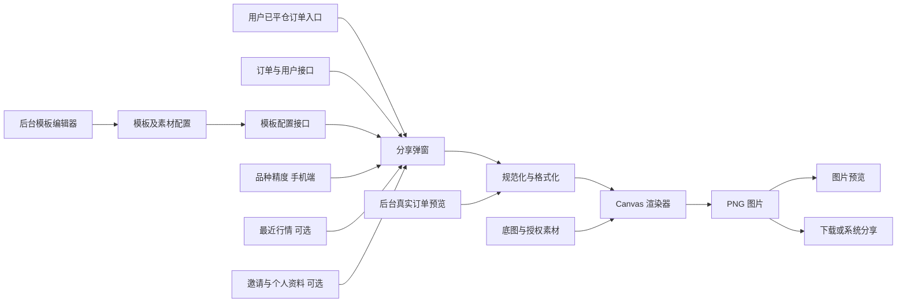
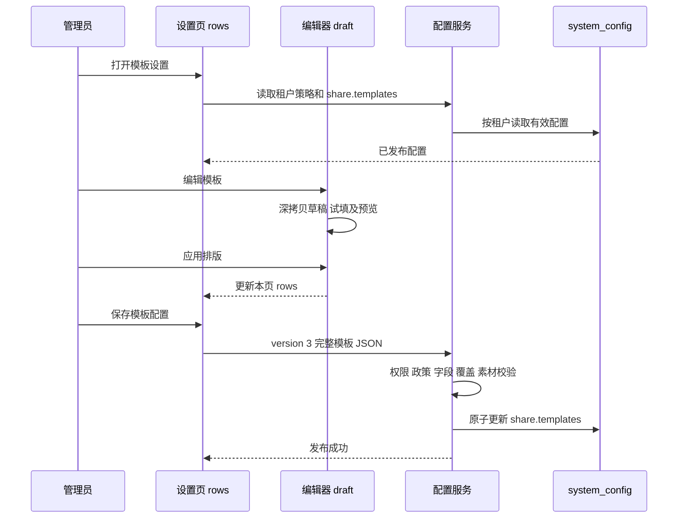
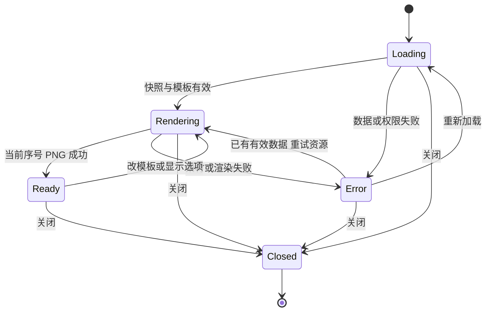

# 分享图模块完整设计与迁移方案

> 用途：从 705 项目抽出分享图的真实设计，供另一项目学习、拆分任务和实现类似功能。
>
> 分析日期：2026-10-13。基线为当前工作区文件，包含未提交修改；Git HEAD 为 `6841273323aec30486099076a1708a02c4b23917`，不能把该提交本身当作本文全部内容的快照。数据库依据仓库内 2026-10-07 的无业务数据结构快照及实体映射，未连接运行数据库。
>
> 第 1～10 章描述当前实现；第 11 章说明发现的问题；第 12～16 章是新项目建议，尚未在 705 实现。第 17 章提供源码及测试索引。本文只新增设计文档，不修改交易、模板配置或用户数据。

## 1. 先理解这个模块

分享图不是给订单卡片截图。它由四类输入组合成一张独立图片：

1. **业务数据**：已结算订单、实际盈亏、收益率分母、成交价格和时间。
2. **模板规则**：哪些模板可用、适用语言、排列顺序、展示重心、字段及装饰排版。
3. **展示上下文**：语言、显示时区、品牌、价格精度、隐私开关和邀请二维码。
4. **视觉素材**：内置底图、后台上传图片、形状、真实行情数据。

当前项目由浏览器 Canvas 绘制并导出 PNG。后端负责读取数据、配置校验、权限及素材访问，没有独立的“生成分享图”服务，也没有分享图片表、分享次数表或图片生成历史表。`ShareHistoryTest` 测的是历史 K 线，不是分享记录。

学习时应保留的核心分工：**业务模块决定事实，模板决定布局，格式化器决定显示，渲染器决定像素，后台决定发布内容。** 模板编辑不应改变订单事实。

### 1.1 当前能力概览

| 范围 | 当前能力 | 边界 |
| --- | --- | --- |
| 订单分享 | 已平仓合约、已平仓期权 | 不分享持仓浮盈；不分享被删除订单 |
| 用户端 | 手机基础版、高级交易版、PC 交易页 | PC 分享入口在 `DesktopTrade.vue` |
| 图片生成 | Canvas、本地 PNG 预览、下载、系统文件分享 | 不保存成服务端图片链接 |
| 模板 | 16 个内置底版、自定义模板、按语言筛选 | 配置最多 32 款，JSON 最多 60,000 UTF-8 字节 |
| 多语言 | 19 种语言 | 当前中文模板语言是 `zh-TW` |
| 后台编辑 | 字段布局、装饰、图片、图层、试填数据 | 没有任意脚本或 HTML 模板 |
| 后台预览 | 示例缩略图、编辑器试填、真实订单预览 | 三者的数据来源和用途不同 |
| 分享记录 | 无 | 下载成功提示仅表示已触发浏览器下载动作 |

当前声明技术栈是 Vue 3、TypeScript、Vite、Canvas、`qrcode`；后台 UI 使用 Element Plus；后端编译目标 Java 8、Spring Boot 2.7.18，配置持久化使用 JPA。实际部署 JDK、浏览器行为、生产配置值不由静态代码证明。新项目应适配自身技术栈，不需要复制这些版本。

## 2. 页面、入口与功能边界

### 2.1 用户页面

| 页面 | 分享入口 | 打开后传入 |
| --- | --- | --- |
| 手机基础版订单页 | 合约历史、期权已平仓订单卡片 | `orderId`、`kind` |
| 手机高级交易页 | `status === 'CLOSED'` 的订单 | 订单 ID、类型 |
| PC `DesktopTrade.vue` | 合约、期权已平仓行 | 订单 ID、类型、`desktop` 标识 |

弹窗主要区域：图片预览、可用模板切换、显示选项、保存及分享。支持按钮切换、左右键、滑动、Escape、遮罩关闭，关闭后恢复页面滚动和焦点。

显示选项：

- 默认同时显示盈亏和收益率，可分别关闭，形成 `both / amount / rate / none` 四种模式。
- 收益率无法计算时禁用用户端收益率开关。
- 邀请二维码默认关闭。
- 模板含可见的姓名或邮箱字段时，才显示个人信息开关；用户端默认关闭。
- 用户端没有任意选择显示时区的控件，时区来自语言偏好及设备规则。
- 内置用户端调用默认 `openTime=false`，没有开仓时间开关；平仓时间仍展示。自定义排版必须保留开平仓时间字段。

当前内置渲染路径不绘制保证金、投入本金、手续费和订单编号，即使旧调用参数仍传入这些开关。渲染器内部需要保证金或投入金额计算收益率，不代表要把它们放在图片上。

### 2.2 后台页面

| 页面/区域 | 作用 | 是否修改订单 |
| --- | --- | --- |
| `/share-templates` | 新增、复制、启停、排序、语言绑定、编辑、发布 | 否 |
| 模板缩略图/放大 | 使用固定示例查看视觉效果 | 否 |
| 模板编辑器 | 调整画布、字段、装饰和样式，手填预览数据 | 否 |
| 素材库 | 上传、保存装饰素材、插入、删除库记录 | 否 |
| 订单管理“查看分享图” | 根据本行订单及所属用户生成真实预览 | 否；接口只读 |
| 用户选择/邀请预览 | 查看指定用户已有邀请码，预览其二维码 | 否；缺码不生成 |
| 系统设置/租户策略 | 品牌、模板和素材配置权限、锁定政策 | 不属于图片排版 |

人工订单创建、绑定、平仓、期权收益预设是其他业务模块。人工订单可能成为分享的数据来源，但不能把这些交易操作并入模板编辑器。当前人工合约入口另受 `SUPER_ADMIN` 与 `orders:manual_order` 限制。

## 3. 总体架构与业务链

### 3.1 当前架构



这是一套逻辑模块，当前并未封装为一个独立公共包。手机、PC、后台分别存在 `orderShare.ts`；后台和 PC 又跨目录复用手机端的自定义排版及素材工具。这样的复用减少了部分重复，但不等于三端所有业务规则已经一致。

### 3.2 用户生成链

1. 点击已平仓订单，记录 ID 和合约/期权类型。
2. 清空旧订单、预览、模板列表和个人信息，递增生成序号。
3. 并行读取当前用户已平仓订单列表、当前语言模板配置；手机另读品种列表获取价格精度，并等待时区初始化。
4. 从返回列表按 ID 找订单，校验并转换为绘图订单。
5. 按语言和启用状态筛选模板。恢复该语言的上次选择；失效时用第一款可用模板。
6. 等待字体、底图、自定义图片；根据选项加载邀请、个人信息和真实行情。
7. 将原始时间转换成指定时区显示文字，按对应精度格式化数据。
8. 绘制 Canvas，导出 PNG Blob，创建 Object URL 展示同一张图片。
9. 下载；支持系统文件分享时打开分享面板，不支持时回退下载。
10. 关闭或切换身份时丢弃旧异步结果，撤销图片 URL，释放素材缓存。

用户订单列表当前**不分页**，返回本租户当前用户全部未删除的指定状态订单，按创建时间倒序。因此没有默认分页漏旧单的问题；但每次打开分享都取全量订单，数据规模大时成本会上升。

### 3.3 后台模板发布链



三个状态必须区分：**已发布配置、设置页未保存修改、编辑器未应用草稿**。当前“应用排版”不发布；关闭编辑器会丢弃未应用部分；刷新页面没有服务端草稿恢复能力。

素材库是另一条立即保存链：上传文件后调用素材入库接口，成功即持久化。取消模板编辑不会自动撤销已上传文件或已入库素材。

### 3.4 后台真实订单预览链

1. 订单列表只对未删除、已平仓行提供按钮；未绑定用户时禁用。
2. 读取 `/admin/orders/{kind}/{id}/share-preview` 和模板配置。
3. 后端检查租户、管理员/代理范围、订单状态、所属用户，并返回原始结算信息、用户姓名邮箱和品牌。
4. 后台切换语言、时区、模板、显示模式后，本地重新生成 PNG。
5. 二维码额外读取**订单所属用户**的邀请预览；真实账户且有 `users:view` 才允许，模拟账户禁用后台邀请二维码。
6. 模拟账户通过账户查询网关转发只读 GET；网关本身使用 POST 并不表示修改订单。

当前后台真实预览默认允许个人信息、默认关闭二维码；与用户端的个人信息主动开启规则不同。后台 share-preview 在 orders 查看权限下始终返回 owner 姓名邮箱，弹窗标题区域也会显示；personal 开关只控制图片绘制，不控制接口读取。users 查看权限另外约束邀请预览。下载文件名含 REAL/DEMO、类型、订单 ID、语言和模板 ID，但图片本身没有统一的模拟账户水印。

## 4. 业务数据、计算公式和有效性

### 4.1 当前绘图订单模型

这是前端 `ShareOrder` 的逻辑含义，不是新数据库表。

| 字段 | 含义/来源 | 规则 |
| --- | --- | --- |
| `id` | 订单 ID | 转字符串，仅用于定位/文件命名；内置图不展示 |
| `kind` | contract / option | 决定方向文案和收益率分母 |
| `symbol` | 原始品种代码 | 行情请求保留原始代码，不用展示名替代 |
| `buy` | BUY 或 UP 为 true | 合约仅接受 BUY/SELL，期权仅接受 UP/DOWN |
| `profit` | 绘图盈亏 | 用户端合约按净盈亏转换；后台现状见 4.2 |
| `openPrice` / `closePrice` | 成交价 | 有效有限数，且大于 0 |
| `leverage` | 订单杠杆 | 可为空，不能拿当前品种杠杆替代历史订单杠杆 |
| `quantity` / `quantityUnit` | 数量及单位 | BASE_ASSET 用资产单位，SHARE 用股，其他 lots |
| `margin` | 合约收益率分母 | 不直接绘制 |
| `amount` | 期权投入金额 | 不直接绘制；它不是模板中的盈亏字段 `amount` |
| `fee` | 费用 | 用于用户端新合约净盈亏转换，不直接绘制 |
| `openTime` | 开仓时间 | `openTime` 缺失时回退 `createdAt` |
| `closeTime` | 平仓时间 | 必须存在且可解析 |
| `currency` | 结算币种标签 | 使用 `settlementCurrency`，缺失回退 USD |
| `pricePrecision` | 品种价格显示小数位 | 手机端新增；PC/后台当前未完整传递 |
| `userName` / `userEmail` | 可选个人信息 | 用户同意展示且模板有字段时才绘制 |

命名上的两个 `amount` 要特别注意：**ShareOrder.amount 是期权本金；ShareField.amount 是盈亏金额的布局字段。** 新项目建议把业务字段改为 `returnBase`、`realizedNetPnl`，减少误用。

### 4.2 当前盈亏口径

用户端合约采用历史兼容判断：

```text
lotSize 非空的新合约订单：分享盈亏 = 数据库 profit - fee
lotSize 为空的旧合约订单：分享盈亏 = 数据库 profit
期权：分享盈亏 = 数据库 profit
```

新合约缺有效手续费时，用户端不把它假定成 0，订单规范化失败。

后台分享预览接口同时返回 `profit` 和 `netProfit`，其中新合约 `netProfit=profit-fee`。但后台绘图转换器当前只读 `raw.profit`、忽略 `netProfit`。因此 **lotSize 非空且 fee 非零的新合约，后台图与手机/PC 的盈亏及收益率确实不同**。

例如原始 `profit=125`、`fee=5`、`margin=1000`：用户端显示 `+120.00 USD / +12.00%`，后台当前显示 `+125.00 USD / +12.50%`。这是实现差异，不是模板风格。

### 4.3 当前收益率公式

```text
合约收益率 = 绘图盈亏 / 订单 margin × 100%
期权收益率 = 绘图盈亏 / 订单 amount × 100%
```

分母缺失或 `<=0`，或结果非有限数，返回不可用。不能伪造为 0%。直接调用内置渲染器时，双指标展示会把可用金额作为重心，单独请求收益率时用破折号。真实用户弹窗会先隐藏不可用收益率：金额开关开启时采用 amount，金额也关闭时采用 none；不会强行显示一个收益率占位指标。

手续费不能在多个层级重复扣除。新项目应让业务适配器输出确定的净盈亏及口径，渲染器只接收最终值。

### 4.4 当前订单校验

必须满足：CLOSED；ID 和品种存在；盈亏有效；开平仓价格有效且大于 0；平仓时间存在且可解析；方向合法。被删除订单在服务端列表/后台预览被排除。

当前 `settledShareOrder` 不完整校验开仓时间有效性及“平仓不能早于开仓”；编辑器的试填校验会检查时间先后。不能把编辑器校验自动视为真实订单校验。新项目应在统一数据快照校验中补齐。

### 4.5 编辑器试填公式

试填不是结算重算：

```text
方向系数：做多 +1，做空 -1
试填收益率 = (平仓价 / 开仓价 - 1) × 方向系数 × 杠杆 × 100
固定示例保证金 = 1000 USD
试填盈亏 = 试填收益率 × 10
```

它不计算实际手续费、汇率、历史合约规格。试填订单 ID 为 PREVIEW，不写交易。缩略图还使用示例蜡烛图；这些数据只能证明排版效果，不能作为客户盈利证据。

## 5. 价格精度、数值显示和时间

### 5.1 存储精度与显示精度

订单价格、利润、手续费等使用 `DECIMAL(32,16)` 存储；品种表 `trading_symbol.price_precision` 决定价格显示小数位。两者不同。

例如存储 `161.305123456789`，显示精度 3 时显示 `161.305`；不能把格式化后的值写回订单、计算收益率或发给交易接口。

### 5.2 当前三端价格矩阵

| 绘制路径 | 内置模板 | 自定义 design |
| --- | --- | --- |
| 手机 | 品种 `pricePrecision`；整数 0～16，否则 2；固定小数位并补零 | 同样用订单 `pricePrecision`，缺省 2 |
| PC | `maximumFractionDigits:16`，不固定补零 | 复用手机自定义渲染器，但订单没有传精度，回退 2 |
| 后台 | `formatPrice` 固定 3 位小数 | 转入手机自定义渲染器，未传精度时回退 2 |

所有上述数值分组使用 `en-US` 千分位，并不随图片语言改成逗号小数点。

手机精度来自 `GET /market/all`，按原始 symbol 匹配。这是**当前品种配置**，不是订单成交时的精度快照；修改品种精度会影响之后生成的历史订单图片。市场列表请求失败会阻止手机弹窗加载，即使订单本身完整。

### 5.3 其他数值

| 数值 | 当前规则 | 新项目建议 |
| --- | --- | --- |
| 盈亏金额 | 固定 2 位，正值 `+`，负零归零 | 结算币种策略可配置；至少先统一三端 |
| 收益率 | 固定 2 位，正值 `+`，末尾 `%` | 从原始净盈亏及分母算，不从已格式化文字算 |
| 数量 | 通常 2 位，默认不展示 | 若需要展示，使用数量精度及资产单位 |
| 杠杆 | 内置模板通常按整数；自定义直接 `${leverage}×` | 统一整数/小数杠杆规则 |
| 缺失值 | 使用破折号，不替换为盈利或 0% | 错误数据阻止生成，真正不可用数据明确占位 |

当前数值先转 JavaScript Number，再 `toFixed` 和 Intl。小数位允许 16 并不意味着所有金额和极小价格都能保持 DECIMAL 的十进制精确性。新项目应保持原始 decimal 字符串，复用自身已有十进制工具或服务端确定的显示值，避免在模板层新增金融计算。

内置模板通常正盈亏绿色、负盈亏红色、零/不可用灰色；自定义模板当前使用字段配置的固定颜色，未自动按正负切换。迁移时需要把“固定色”与“按盈亏变色”作为明确规则。

### 5.4 当前时间处理

必须区分四个概念：原始成交时间、解释原始时间的时区、图片显示时区、图片生成时间。

- 开仓与平仓时间来自订单已存字段，不采用打开分享弹窗的当前时间。
- 当前数据库使用 `DATETIME(6)`，Java 实体使用 LocalDateTime；本身不携带时区。
- 服务配置声明 Jackson/JDBC UTC，普通结算代码又使用 `LocalDateTime.now()`。仅设置 Jackson 时区不能使 LocalDateTime 自动成为带偏移瞬间；具体生产 JVM 默认时区未在本轮核验。
- 当前海报显示格式为 `YYYY-MM-DD HH:mm:ss`，24 小时制，显示到秒，并附时区名称。
- 没有单独展示“图片生成时间”的业务字段。

| 调用路径 | 无时区字符串处理 | 显示时区来源 |
| --- | --- | --- |
| 手机真实分享 | 先按 UTC 解析，再转 ISO 后格式化 | 显式语言对应地区；否则浏览器时区，再回退 |
| PC 真实分享 | 直接调用日期工具，无偏移值被当作 UTC+8 | 同样使用语言/设备显示规则 |
| 后台真实订单预览 | 按 UTC 解析 | 默认语言映射，可手选 IANA 时区 |
| 后台试填 | 编辑器输入日期文字；“时间标注”是自由文本 | 不是实际时区转换器 |

同一无偏移原始字符串，PC 与手机会解释为相差 8 小时的瞬间。原始数据已有 `Z` 或偏移时，不适用这个结论。

后台真实预览切换语言会重新设置映射时区，覆盖刚才手选值。该行为要在新项目明确决定，不能由 watcher 偶然决定。

### 5.5 当前语言与时区规则

当前显式语言时区映射如下。没有已保存的语言选择时优先设备时区；图片语言变成英语不必然表示用户主动选择了纽约时区。

| 语言 | 时区 | 语言 | 时区 |
| --- | --- | --- | --- |
| en | America/New_York | fr | Europe/Paris |
| de | Europe/Berlin | ru | Europe/Moscow |
| es | Europe/Madrid | pt | Europe/Lisbon |
| it | Europe/Rome | ar | Asia/Riyadh |
| tr | Europe/Istanbul | id | Asia/Jakarta |
| my | Asia/Yangon | hi | Asia/Kolkata |
| cs | Europe/Prague | pl | Europe/Warsaw |
| ja | Asia/Tokyo | ko | Asia/Seoul |
| zh-TW | Asia/Taipei | th | Asia/Bangkok |
| vi | Asia/Ho_Chi_Minh | | |

`GET /user/system/timezone` 存在，默认 Europe/London；但不能概括为“分享图全部按后台系统时区显示”。用户分享实际调用的是显示时区工具。

新项目建议：接口统一返回 UTC Epoch 毫秒或带 `Z`/偏移的 ISO 字符串；显示使用合法 IANA 时区。语言负责翻译，时区负责时间转换；用户显式时区优先语言默认值。旧的无时区历史数据应在业务适配器内根据已知存储约定转换一次。

## 6. 模板、排版与多语言设计

### 6.1 内置模板和实际尺寸

当前内置底版 16 款，输出宽度均为 1080。以下尺寸是当前代码行为，不能继续使用旧文档“全部 1080×1440”的描述。

| ID | 后台名称 | PNG 尺寸 | 内置路径需要真实行情 | 底图 |
| --- | --- | --- | --- | --- |
| light | 极简方刊 | 1080×1080 | 否 | Canvas |
| dark | 专业黑 | 1080×1440 | 否 | Canvas |
| chart | 行情图 | 1080×1440 | 是 | Canvas |
| gold | 黑金横幅 | 1080×675 | 否 | Canvas |
| globe | 环球 | 1080×1440 | 否 | Canvas |
| architecture | 建筑 | 1080×1440 | 否 | Canvas |
| city | 城市 | 1080×1440 | 否 | Canvas |
| referenceGold | 黑金原版 | 1080×1440 | 是 | reference-gold.png |
| referenceWhite | 白色原版 | 1080×1440 | 是 | reference-white-neutral.png |
| referenceTerminal | 行情原版 | 1080×1440 | 是 | reference-terminal.png |
| launch | 启航 | 1080×1440 | 否 | launch.png |
| aurora | 青绿星环 | 1080×1350 | 否 | aurora.png |
| racing | 斜切竞速 | 1080×785 | 否 | racing.png |
| receipt | 纸感票据 | 1080×1665 | 否 | Canvas |
| journal | 行情终端 | 1080×720 | 是 | Canvas |
| voyage | 旅程 | 1080×1440 | 否 | voyage.png |

7 张内置 PNG 存于各端 `public/share-templates/`，背景不烘焙订单数值或品牌文字。自定义 design 使用自己的宽高；即便 base 是 chart，也不自动继承内置图表区域，因为自定义字段类型没有图表字段。

### 6.2 配置版本

`share.templates` 兼容：

| 格式 | 内容 | 用途 |
| --- | --- | --- |
| 未配置 null | 16 个内置模板全部可用 | 默认配置 |
| CSV | 有序内置 ID | 旧配置，视为全语言通用 |
| version 2 | `templates:[{id,languages}]`，可选顶层 focus | 语言范围、旧全局展示重心 |
| version 3 | 每模板 name/base/languages/focus/enabled/design | 当前后台发布格式 |

`version` 是 **JSON 格式版本**，不是发布次数、数据库行版本或并发控制版本。v3 中每款模板有独立 focus；顶层 focus 主要保留兼容。

当前可直接采用的最小配置示例：

```json
{
  "version": 3,
  "templates": [
    { "id": "light", "name": "通用分享", "base": "light", "languages": ["*"], "focus": "rate", "enabled": true },
    { "id": "referenceWhite", "name": "日语行情", "base": "referenceWhite", "languages": ["ja"], "focus": "amount", "enabled": true }
  ]
}
```

在该顺序中，没有有效本地记忆选择时，日语默认也会是 light。若希望日语首选候选为 referenceWhite，应把该行移到前面；其他语言继续使用 light。

### 6.3 模板筛选和默认规则

```text
可用模板 = 配置数组中 enabled 且语言范围包含当前语言或 * 的项目
顺序 = 原配置数组顺序
默认 = 第一款可用模板
实际选择 = 当前语言记忆的模板仍可用时使用记忆值，否则默认
```

没有独立 default 字段。把通用模板移到第一位，会改变它覆盖语言的默认候选；仍有效的用户本地记忆优先，不会因此立即改变每个用户的选择。用户选择记忆键为 `order-share-template:{language}`。

保存校验：1～32 个模板；ID 不重复；内置 ID 合法；自定义 ID 为 `custom-[a-z0-9-]{1,48}` 且必须有 design；名字非空且最多 80 字；base 属于 16 个内置底版；focus 只能 amount/rate；enabled 为布尔值，缺省 true。

语言范围不能为空，不能重复，`["*"]` 不能混入其他语言；全部支持语言必须至少被一个启用模板覆盖。停用一个语言唯一可用模板会阻止发布。

### 6.4 排版数据结构

```text
ShareDesign
  width, height          画布真实像素
  background             六位 HEX 背景色
  artwork                是否使用底版图片
  boxes[]                业务字段盒子
  decorations[]          形状及图片
  layers[]               两类图层的完整绘制顺序
```

| 数据 | 主要字段 | 校验 |
| --- | --- | --- |
| 字段盒子 | field/x/y/width/height/fontSize/color/align/weight/label/visible | 只允许固定字段；不能重复；宽高至少 20；盒子在画布内 |
| 装饰 | id/name/type/x/y/width/height/fill/stroke/strokeWidth/radius/opacity/visible | 装饰最多 40，宽高至少 2；图片最多 16 |
| 图片装饰 | src/fit | 本租户员工图片命名空间；fit 为 contain/cover/stretch |
| 图层列表 | `box:<field>` 或装饰 id | 每个现有字段/装饰恰好出现一次，不能遗漏、重复 |

画布宽高整数 320～2160；字号 8～200；对齐 left/center/right；字重 400/500/600/700/800；透明度 0～1；描边宽 0～100；圆角 0～1080。**40 是装饰数量上限，不是所有图层总数上限**，字段盒子另计。

固定字段：brand、symbol、direction、leverage、amount、rate、openPrice、closePrice、openTime、closeTime、userName、userEmail。

自定义排版必须保留可见字段：symbol、leverage、rate、openPrice、closePrice、openTime、closeTime。后台编辑器不提供固定字段删除动作；配置协议允许省略非必需字段，也可将它们隐藏。模板要求 rate 可见与用户主动隐藏收益率是两个层级：前者保证模板能力，后者控制当次导出隐私。

当前无任意文字层、旋转、多选对齐、撤销重做或字体家族选择器。字体长文本自动缩小，最小到 8 px，并裁剪在盒子内。二维码和底部说明在图层绘制之后单独叠加，不受 `layers` 排序控制。

### 6.5 可校验的自定义配置示例

以下示例完整保留必需字段，不依赖上传图片。它可用来理解数据模型；不意味着本轮已发布该配置。

```json
{
  "version": 3,
  "templates": [{
    "id": "custom-demo", "name": "学习用竖版", "base": "light",
    "languages": ["*"], "focus": "rate", "enabled": true,
    "design": {
      "width": 1080, "height": 1440, "background": "#ffffff", "artwork": false,
      "boxes": [
        { "field": "brand", "x": 64, "y": 64, "width": 952, "height": 64, "fontSize": 36, "color": "#172b35", "align": "left", "weight": 700, "label": false, "visible": true },
        { "field": "symbol", "x": 64, "y": 160, "width": 952, "height": 80, "fontSize": 56, "color": "#172b35", "align": "left", "weight": 700, "label": false, "visible": true },
        { "field": "direction", "x": 64, "y": 260, "width": 430, "height": 64, "fontSize": 32, "color": "#546571", "align": "left", "weight": 500, "label": false, "visible": true },
        { "field": "leverage", "x": 560, "y": 260, "width": 456, "height": 64, "fontSize": 32, "color": "#546571", "align": "right", "weight": 500, "label": true, "visible": true },
        { "field": "rate", "x": 64, "y": 360, "width": 952, "height": 160, "fontSize": 120, "color": "#172b35", "align": "left", "weight": 800, "label": true, "visible": true },
        { "field": "amount", "x": 64, "y": 550, "width": 952, "height": 110, "fontSize": 70, "color": "#172b35", "align": "left", "weight": 700, "label": true, "visible": true },
        { "field": "openPrice", "x": 64, "y": 730, "width": 430, "height": 90, "fontSize": 42, "color": "#172b35", "align": "left", "weight": 500, "label": true, "visible": true },
        { "field": "closePrice", "x": 560, "y": 730, "width": 456, "height": 90, "fontSize": 42, "color": "#172b35", "align": "right", "weight": 500, "label": true, "visible": true },
        { "field": "openTime", "x": 64, "y": 880, "width": 952, "height": 80, "fontSize": 28, "color": "#546571", "align": "left", "weight": 400, "label": true, "visible": true },
        { "field": "closeTime", "x": 64, "y": 1000, "width": 952, "height": 80, "fontSize": 28, "color": "#546571", "align": "left", "weight": 400, "label": true, "visible": true }
      ],
      "decorations": [],
      "layers": ["box:brand", "box:symbol", "box:direction", "box:leverage", "box:rate", "box:amount", "box:openPrice", "box:closePrice", "box:openTime", "box:closeTime"]
    }
  }]
}
```

它使用固定深色指标，未配置正负变色；底部保留二维码及说明空间。颜色、布局和指标显示都不能改变订单实际结果。

### 6.6 多语言

支持 zh-TW、en、fr、de、ru、es、pt、it、ar、tr、id、my、hi、cs、pl、ja、ko、th、vi。区域码归一化：下划线转连字符；中文归 zh-TW；其他取主语言；未知回 en。

“全语言通用”表示模板适用于全部语言，文字仍按当前语言绘制。品牌名、原始品种、币种代码、行情来源、时区和数值不翻译。内置图片避免烘焙文字，业务标签、方向、说明由字典绘制。

新项目仅需覆盖自己的支持语言；若新增简体中文，应增加 zh-CN 字典、归一规则、语言覆盖校验和界面选项，不能只给旧字典换名称。阿拉伯语等文本方向及字体覆盖需要实际浏览器验收，存在字典不等于已证明排版正确。

## 7. 后台编辑器详细业务设计

### 7.1 页面分区

| 区域 | 当前操作 |
| --- | --- |
| 模板面板 | 名称、底版、语言、重心、背景色、底版图片开关 |
| 图层面板 | 选字段/装饰、上移下移、置顶置底、装饰复制删除 |
| 素材库面板 | 名称搜索、每页 12 条、上传、插入、保存当前装饰、删除 |
| 中间画布 | 最终渲染图及定位框，拖动、缩放 |
| 样式面板 | 坐标、宽高、字号、颜色、字重、对齐、标签、显隐 |
| 装饰样式 | 填充、描边、线宽、圆角、透明度、图片 fit |
| 试填区域 | 品种、方向、杠杆、价格、时间、姓名邮箱、品牌、时间标注 |

画布预设 1080×1440、1080×1080、1440×900；切换时坐标/尺寸按 X/Y 比例缩放，字号按较小比例缩放。支持方向键移动 1 px、Shift+方向键移动 10 px；字段和装饰限制在画布内。

重心属于每个模板。内置渲染按 amount/rate 调整主次指标；自定义编辑器切换重心时，交换 rate/amount 两个盒子除 field、visible 外的全部属性，包括位置、尺寸、字号、颜色、对齐等。缺其中一个盒子时不交换，只改规则 focus。它不是切换到一套新的内置布局。

### 7.2 管理动作

- 新增：生成 custom ID，默认 light 底版、rate 重心、启用、绑定当前预览语言。
- 复制：深拷贝排版，生成新 custom ID，名称追加副本。
- 删除：仅允许删除 custom 模板；内置模板通过停用处理。
- 排序/设默认：移动配置数组；影响其覆盖的语言。
- 启停：只影响发布后的可用列表；停用内容不能让语言覆盖为空。
- 应用排版：更新设置页本地数据。
- 保存模板配置：前后端双重校验后发布完整配置。
- 素材删除：立即软删除库项目，已经复制进模板的图层仍保留。

当前没有页面离开确认、模板导入导出、服务端草稿、发布历史页面、回滚入口或配置 revision 冲突提示。这些是可选增强，不能当现有功能演示给学习项目。

### 7.3 示例、试填和真实预览

| 项目 | 列表缩略图 | 编辑器试填 | 真实订单预览 |
| --- | --- | --- | --- |
| 数据 | 固定示例 | 管理员输入 | 订单已存事实 |
| 盈亏 | 示例值 | 简化价格公式 | 当前后台 raw.profit |
| 行情 | 示例 K 线 | 排版用途 | 当前最近 K 线 |
| 用户 | 无客户请求 | 可选真实用户用于邀请，也可手填姓名邮箱 | 订单所属用户 |
| 品牌/时间 | DEMO、UTC 示例 | 手填品牌和时间标注 | 配置品牌及真实时间转换 |
| 修改交易 | 否 | 否 | 否 |

新项目建议在预览面板持续显示“示例排版”或“真实结算订单”，但不把开发实现细节塞进用户分享流程。

## 8. 图片素材、行情、邀请与生成

### 8.1 素材生命周期

当前素材库配置键 `share.materials`，格式为：

```text
{ version:1, materials:[{ id, name, layer, deleted }] }
```

最多 100 个未删除项、500 个含软删除历史项；整体最多 60,000 UTF-8 字节。素材是装饰图层的副本，可以是形状，也可以是图片，并不只表示图片文件。

链路：选择文件；前端安全处理；`POST /upload/image`；获得受控 URL；生成图片图层；`POST /admin/share-materials` 入库；复制入当前模板草稿。模板里保留图层副本，不是一个会随库项目改变的动态外键引用。

### 8.2 上传和读取边界

| 环节 | 当前规则 |
| --- | --- |
| 前端文件准备 | PNG/JPEG/GIF/WebP/静态 SVG；单文件不超过 5 MB，图片最多 20,000,000 像素 |
| SVG | 静态标签和属性白名单，禁止脚本/外部资源/嵌入图片；转换 PNG；尺寸 1～2160 |
| WebP | 前端转换为 PNG 后上传，不直接依赖后端 WebP 解码 |
| 服务端上传 | MIME 初筛，再解码内容；PNG/JPEG/GIF/BMP；不超过 5 MB、25,000,000 像素 |
| 服务端存储 | GIF 保留原字节，其他重新编码 PNG；UUID 命名；本地或既有 MinIO 存储 |
| 模板图片地址 | 只允许本租户员工上传命名空间的 jpg/jpeg/png/gif/webp 路径 |
| 素材请求 | 带当前 Bearer，omit cookies，no-store，禁止重定向，15 秒超时 |
| 缓存 | 调用者自己持有，按身份失效，关闭撤销 Object URL |

因此“后台可选 WebP/SVG”与“服务端原始上传可直接接收 WebP/SVG”不是同一件事。跨项目迁移不能只复制 accept 扩展名。

文件实际权限分两层：模板保存时验证文件属于本人或本租户已入库/已引用员工素材；文件读取时验证当前租户及引用状态。用户可读已启用模板中可见图片，不能凭素材库有记录就读取后台所有文件。草稿、隐藏图层、停用模板与公开已发布图片的读取规则要分开。

### 8.3 当前行情用途

内置 chart、journal、三个 reference 模板需要图表。当前请求 `GET /market/kline/{symbol}?interval=1m&limit=80`，使用最近最多 80 根一分钟蜡烛图。用户端 pending 时约每 1.5 秒重试，最多 8 次；后台真实预览单次请求，返回状态不满足要求则报错，由用户重新预览。校验响应品种，过滤/排序有效数据，缺行情显示错误及重试，不补造蜡烛图。

**当前图是近期市场行情，不是该订单持有区间回放。** 后端虽有历史 K 线接口、前端虽保留 historyWindow/coveredCandles 工具，分享弹窗目前未使用这条历史窗口链。

自定义 design 当前没有 chart 字段，仅用字段盒子与装饰；不要在方案中声称编辑器可以拖动真实 K 线组件。

若新项目需要成交区间图，必须另定义历史数据时间窗、开平仓标记、行情来源及缺失处理，并使用有权限的历史接口。这是新增功能。

### 8.4 邀请二维码

二维码来自用户已有/生成的邀请码，与订单或模板 ID 无关。当前二维码参数：320 px、margin 2、纠错级别 M。

| 场景 | 邀请来源 | URL |
| --- | --- | --- |
| 手机用户分享 | `/user/invite/info` | 当前 origin + pathname + `#/register?invite=...` |
| PC 用户分享 | `/user/invite/info` | 当前 origin + pathname + `#/?register=1&invite=...` |
| 后台试填/真实预览 | `/admin/users/{id}/invite-preview` | 已验证租户前台 origin + `/?register=1&invite=...` |

用户 `GET /user/invite/info` 缺邀请码时会生成并保存，带写副作用。后台邀请预览缺码直接报错，不生成、不持久化。

后台真实预览用订单 owner 的邀请信息，需要 users 查看权限；不能用后台登录者的邀请码。编辑器切用户、清除用户、换 token、关闭时都有过期请求丢弃逻辑。

新项目建议统一由邀请模块返回完整合法 registration URL；分享模块只负责编码，不自行拼三套路由。邀请创建独立使用写接口，读取预览保持只读。

### 8.5 Canvas、导出和错误状态

渲染顺序是：画布背景、底图、装饰和字段图层、二维码及固定说明；内置模板另外绘制行情。等待字体加载后绘制，避免字体到达后改变图片内容。

用户端 PNG Blob 同时用于预览、下载和文件分享，保持预览与导出一致。文件分享使用 capability 检测；用户取消分享不当作生成失败。不支持时下载并提示。后台编辑器/真实订单预览使用 PNG Data URL 展示及下载，没有系统文件分享入口。

生成必须显式区分 loading/rendering/ready/error。配置失败、订单缺失、底图失败、素材越权/失效、行情缺失、Canvas/Blob 失败均应清空旧图，并提供对应重试路径。用户不能下载上一订单或上一身份的旧预览。

当前 generation/revision 防护负责旧最终预览不覆盖新预览；但用户端二维码组件缓存存在另一个身份切换问题，见第 11 章。

## 9. 当前后端接口清单

以下是完整 HTTP 路径；前端 request 的 baseURL 已包含 `/api`。

| 方法/接口 | 输入 | 结果与用途 | 身份/边界 |
| --- | --- | --- | --- |
| GET `/api/trade/contract/orders` | status=CLOSED | `{list,total}`，不分页 | 当前租户当前用户，未删除 |
| GET `/api/trade/option/orders` | status=CLOSED | `{list,total}`，不分页 | 同上 |
| GET `/api/user/share-templates` | locale，details | 默认 ID 数组；details 返回 templates/focus/definitions/brand | 用户登录；definitions 仅 v3 |
| GET `/api/market/all` | 无分享专用参数 | 品种列表含 pricePrecision | 当前租户行情；手机分享读取 |
| GET `/api/market/kline/{symbol}` | interval=1m，limit=80 | 当前近期行情及来源状态 | 原始 symbol；后台特许范围受限制 |
| GET `/api/market/kline/history/{symbol}` | interval/endTime/limit | 历史行情，当前分享未使用 | 不等于后台特许的单段 kline 路由 |
| GET `/api/user/invite/info` | 当前用户身份 | inviteCode；缺码可能写入 | 当前用户，不是后台只读预览 |
| GET `/api/user/{id}/info` | 用户 ID | 个人资料，用于主动展示姓名邮箱 | 应走既有用户访问权限 |
| GET `/api/user/system/timezone` | 无 | timezone，缺省 Europe/London | 公共读取；不是所有海报的最终显示时区 |
| GET `/api/admin/tenant-policies/share-templates` | 当前租户 | 模板及素材锁定策略 | share_templates 查看、后台身份与租户验证 |
| GET `/api/admin/config/get` | key=share.templates | key/value/brand | share_templates/settings/orders 任一读取权限 |
| POST `/api/admin/config/save` | key/value/description | 原子保存一份配置 | share_templates:save；代理禁止 |
| POST `/api/admin/config/saveBatch` | 配置项数组 | 批量配置入口 | 不等于模板历史/草稿接口 |
| GET `/api/admin/share-materials` | 无 | 未删除素材数组，倒序 | share_templates 查看 |
| POST `/api/admin/share-materials` | name/layer | 新素材记录 | save 权限、租户政策、校验 |
| DELETE `/api/admin/share-materials/{id}` | 素材 ID | 软删除结果 | 同上，不删除模板内副本 |
| POST `/api/upload/image` | multipart file | success/url/message | 登录、图片内容校验、按身份存储 |
| GET `/api/uploads/images/...` | 受控员工文件路径 | 图片字节 | 租户、身份、已发布引用校验 |
| GET `/api/admin/orders/{contract或option}/{id}/share-preview` | 本行订单 ID | 结算字段、owner 资料、brand | orders 查看、只读、未删除/CLOSED/已绑定 |
| GET `/api/admin/users/{id}/invite-preview` | 指定用户 ID | userId/nickname/email/inviteCode/inviteUrl | users 查看、租户及代理范围、已验证域名 |
| GET `/api/admin/users` | userId 或 keyword，page=1，size=20 | 编辑器用户选择 | users 查看 |
| POST `/api/admin/account-query` | 账户通道、table.detail 等查询描述 | 模拟账户查询网关 | 白名单内的只读业务查询 |

没有 `/api/share/generate`、`/api/share/history`、`/api/share/upload-poster` 这些当前接口。学习项目可新增自己的快照读取接口，但应标注为新设计。

模板 details 响应示意：

```json
{
  "templates": ["light"],
  "focus": "amount",
  "definitions": [
    { "id": "light", "name": "通用分享", "base": "light", "languages": ["*"], "focus": "rate", "enabled": true }
  ],
  "brand": "项目品牌"
}
```

实际新客户端会校验 definitions 完整性。v3 以所选 definition 的 focus 为准，不能无条件用顶层兼容 focus 覆盖。

## 10. 当前表、字段和权限设计

### 10.1 直接依赖表

| 表 | 分享模块读取/使用的关键字段 | 作用 |
| --- | --- | --- |
| system_config | tenant_id/config_key/config_value/description/created_at/updated_at | 模板、素材、品牌与系统配置 |
| contract_order | id/tenant_id/user_id/status/deleted_at/symbol/side/open_price/close_price/open_time/close_time/profit/fee/margin/lot_size/leverage/quantity/quantity_unit_type/quantity_asset | 合约结算来源与历史语义 |
| option_order | id/tenant_id/user_id/status/deleted_at/symbol/direction/open_price/close_price/open_time/close_time/profit/amount | 期权结算来源 |
| trading_symbol | tenant_id/symbol/name/price_precision/volume_precision | 当前价格精度、名称与数量规格 |
| user_account | id/tenant_id/nickname/email/my_invite_code | 用户身份及自己的邀请码 |
| tenant | id/frontend_host/domain_verified 等 | 后台生成正确前台邀请链接 |
| tenant_domain_binding | tenant_id/hostname/status/domain_role | 已验证域名与前台/后台角色边界 |
| tenant_policy | tenant_id/policy_key/policy_value/locked/version | 配置锁定/覆盖政策 |
| admin_menu/admin_role/admin_role_menu/menu_action | 既有 RBAC 元数据 | 模板、订单、用户读写权限 |
| control_audit_log | tenant_id/actor/action/object 等审计信息 | 素材创建/移除的明确审计事件 |
| operation_log | 后台通用操作日志 | 既有后台动作日志，不是分享次数记录 |

图表复用行情服务及其数据来源。其背后有行情缓存、历史投影等表，但它们属于行情模块；实现类似分享功能不需要复制整个行情引擎。

### 10.2 system_config 实际结构

| 字段 | 当前 DDL 类型/约束 | 含义 |
| --- | --- | --- |
| id | BIGINT，主键、自增 | 配置记录 ID |
| tenant_id | BIGINT NOT NULL | 租户隔离 |
| config_key | VARCHAR(100) NOT NULL | 键名 |
| config_value | TEXT | JSON/旧 CSV/普通配置值 |
| description | VARCHAR(200) | 配置说明 |
| created_at | DATETIME(6) NOT NULL | 创建时间 |
| updated_at | DATETIME(6) | 更新时间 |
| 唯一键 | tenant_id + config_key | 同租户每个键只一条记录 |

关键键：`share.templates`（v3 模板 JSON）、`share.materials`（v1 素材库 JSON）、`site.name`（品牌）、`system.timezone`（系统默认时区）。模板与素材配置分别限制 60,000 UTF-8 字节，低于 TEXT 的字节容量上限；中文不能按字符数判断容量。

没有 `share_template`、`share_material`、`share_image` 当前独立表。不要拿公告/活动的 `activity_material` 当分享素材表。

### 10.3 交易表字段语义

- contract_order 的价、量、保证金、费用、盈亏多数为 DECIMAL(32,16)，leverage 为 DECIMAL(10,2)。`lot_size` 是否为空决定用户端旧/新盈亏兼容规则。
- option_order 的本金、价格、盈亏为 DECIMAL(32,16)。`profit_rate/loss_rate` 是下单时比例参数，不是分享图直接展示的已实现收益率。
- 两种订单的开平仓时间均为 DATETIME(6)，需与运行环境的存储时间约定一起解释。
- `quote_currency` 是合约报价币，不应自动当作最终盈亏结算币；当前绘图模型缺 settlementCurrency 时回退 USD。
- `user_account.invite_code` 与 `my_invite_code` 含义不同：前者记录邀请关系输入，后者才是用户邀请别人的码。
- 当前品种价格精度没有作为分享专用字段保存在订单上。

### 10.4 权限和多租户边界

| 动作 | 权限/范围 |
| --- | --- |
| 查看模板页面、素材库 | share_templates 查看 |
| 保存模板、创建/移除素材 | share_templates:save + 租户配置政策允许 |
| 从订单页读取配置并预览 | orders 查看；配置读取允许 orders 菜单 |
| 读取 owner 邀请信息 | users 查看 + 当前租户 + 代理可访问用户范围 |
| 查看已平仓订单 | orders 查看；当前租户；代理仅其直接下级；未删除、已绑定；响应包含 owner 姓名邮箱 |
| 用户模板接口 | ROLE_USER，按其当前租户读取 |
| 上传/读取素材 | 受控身份文件命名空间及已发布引用，不信任前端 tenantId |

租户策略快照必须与当前后台租户一致；缺快照不进入编辑状态。模板锁与素材锁分开：素材锁定时仍可读取并插入已有素材，不能修改素材库。

后端保存配置会锁租户并校验政策，保证并发写入的串行执行；但它没有客户端 revision 冲突检查，仍可能由后保存者覆盖先保存者的完整配置。串行写入不等于保护管理员之间的编辑冲突。

后台共享域名只特许指定读取路径，如时区、市场搜索、单 symbol kline；不能因为分享图需要行情就开放全部市场/用户接口。

## 11. 当前明确差异、缺口和迁移注意项

本章是静态源码结论，未把浏览器测试或生产结果描述为本轮已通过。

| 优先级 | 已确认事项 | 对新项目的影响 |
| --- | --- | --- |
| 必须统一 | 新合约后台取毛 profit，用户端取 profit-fee | 同一订单分享结果不同；先定义统一净盈亏 |
| 必须统一 | 手机/PC/后台，内置/自定义价格格式不同 | 单一 formatter 与 pricePrecision 贯穿全部路径 |
| 必须统一 | 无时区时间手机/后台按 UTC，PC 按 +08:00 | 改用明确瞬间；不能靠日期工具的默认猜测 |
| 必须处理 | 用户端 qrImage 跨 token 重载未清空，异步写缓存未做同等 generation 校验 | 换账号且弹窗保留时可能复用旧账号邀请码；所有身份数据缓存按身份隔离 |
| 明确产品选择 | 最近 K 线，而非订单持有区间 | 文案注明近期；历史复盘另做设计 |
| 明确产品选择 | 模拟图无统一水印 | 若目标系统需要识别模拟结果，应明确增加标识 |
| 应统一 | 用户默认不展示个人信息，后台默认展示 | 预览权限和导出选项各自明确，不能偷偷沿用 |
| 应统一 | 自定义固定收益颜色、内置按正负变色 | 定义固定色/语义色策略 |
| 可增强 | 只有页面草稿，无服务器草稿和发布历史 | 刷新恢复、回滚、多人编辑需另实现 |
| 可增强 | 用户分享拉全部订单，另依赖 /market/all | 单订单快照可降低开销并返回精度 |
| 应区分 | 用户邀请 GET 可创建码，后台预览纯只读 | 读与创建接口分开 |
| 验收缺口 | 三端一致性测试特意允许/移除了精度差异 | “源码一致”断言不能证明业务显示一致 |
| 验收缺口 | 旧 focus 浏览器测试仍断言 v2 全局重心 | 不能用它证明当前 v3 每模板发布链路有效 |

旧说明中的“16 模板全部 1080×1440”“全局重心设置”“只支持 v2”“PC/后台与手机完全一致”已不能作为当前设计事实。

## 12. 新项目应抽离成什么

以下为建议方案，不是 705 已存在的独立模块。可用现有框架实现，不要求引入新中间件或更换交易架构。

### 12.1 最小边界

| 模块 | 职责 | 输入/输出 |
| --- | --- | --- |
| ShareSnapshotAdapter | 访问校验、业务来源适配、净盈亏口径 | 已结算业务记录，输出只读分享快照 |
| ShareTemplateService | 配置读取、筛选、校验、草稿/发布 | 模板 JSON、修订号 |
| ShareFormat | 价格、金额、收益率、时间统一显示 | 原始 decimal/瞬间及策略，输出展示文字 |
| ShareRenderer | 内置底版及自定义图层绘制 | 完整 RenderContext，输出 Canvas/Blob |
| ShareAssets | 授权图片、解码、缓存、失效 | 已允许素材 ID/地址与当前身份 |
| ShareDialog | 加载状态、选择、隐私、下载/分享 | 订单 ID + type |
| ShareAdmin | 模板管理、编辑器、三类预览 | 配置和只读样例/真实快照 |

这些可以是目录和普通函数，不需要每项都建一个网络服务。三个页面使用同一套 formatter 和 renderer；业务适配从渲染器移出。

建议目录：

```text
share/
  models.ts
  templateSchema.ts
  format.ts
  renderer.ts
  assets.ts
  builtins/
  locales/
  components/ShareDialog.vue
admin/share/
  TemplateList.vue
  TemplateEditor.vue
  OrderPreview.vue
backend/share/
  snapshot adapter
  template config service
  material access integration
```

React/其他后端可保留相同分工；无需照搬 Vue 或 Java 类名。

### 12.2 统一分享快照契约

新项目建议提供单订单只读接口，并由普通用户与后台预览复用同一快照构造逻辑。授权范围在接口层不同，事实字段及格式策略相同。

```json
{
  "businessType": "contract",
  "businessId": "10001",
  "status": "CLOSED",
  "accountMode": "REAL",
  "symbol": "USDJPY",
  "displaySymbol": "USD/JPY",
  "direction": "SELL",
  "leverage": "100",
  "openPrice": "161.305123456789",
  "closePrice": "161.200000000000",
  "realizedNetPnl": "120.00",
  "returnBase": "1000.00",
  "returnPercent": "12.00",
  "returnBasis": "REALIZED_NET_PNL_OVER_MARGIN",
  "settlementCurrency": "USD",
  "pricePrecision": 3,
  "amountPrecision": 2,
  "returnPrecision": 2,
  "openedAt": "2026-10-13T01:20:00Z",
  "closedAt": "2026-10-13T01:28:00Z",
  "dataRevision": "order-row-version"
}
```

这份示例表达字段契约，收益取已存结算数据，不由示例价格和杠杆反推。后端可返回 returnPercent，或由共享适配器从原始净盈亏/分母计算一次；两种实现选择一种作为权威路径。

快照中的用户身份、完整邮箱和邀请 URL 应按当前选择/权限单独读取或以最小字段返回；不要因为模板可能用到，就让所有快照总带所有个人资料。

每次生成冻结：快照、模板、语言、时区、显示选项、品牌、素材身份、配置 revision。重渲染使用这个上下文，禁止同一图片混入前后两版模板或不同用户资料。

### 12.3 建议固定的业务规则

1. 只生成权限范围内的已结算、未删除记录。
2. 盈亏使用一个明确定义的净值口径；模板不计算利润、不扣手续费。
3. returnBase 为业务适配器给出的真实分母，分母不可用就显示不可用。
4. 原始价与金额用 decimal 字符串；格式化只产生显示文字。
5. 时间使用明确瞬间，只在显示层转换时区。
6. 价格精度统一来源。第一期可用当前品种配置；若要求历史重现，则在业务快照内固定精度策略/版本。
7. 显示姓名邮箱须主动选择，二维码归属当前记录所属用户。
8. 行情用途写清楚：近期背景行情或持有区间回放，不能把两者混为一条链。

## 13. 新项目表设计

### 13.1 首期的最少持久化

如果目标项目已有 system_config、权限、用户、订单和文件存储，最小版本只需新增分享配置键；无需专门建图片表。可沿用当前原子模板 JSON，增加配置 revision，并在既有审计模块记录发布。

若目标项目希望模块独立，建议最多先建以下两张表。订单、用户、品牌、行情仍引用目标项目已有业务模块。

| 表 | 是否必需 | 作用 |
| --- | --- | --- |
| share_template_config | 独立模块时必需 | 同租户完整已发布配置、可选草稿及并发修订号 |
| share_material | 需要后台素材库时增加 | 图层/图片元数据、软删除、文件引用 |
| share_generation | 首期不需要 | 只有服务端存图、可追溯历史或链接分享需求时增加 |
| share_template_revision | 首期可不需要 | 有完整发布回滚需求时保存不可变历史配置 |

### 13.2 独立配置表建议

以下是建表设计示例，未执行。类型以支持 JSON 的 MySQL 为示例；目标项目使用其他数据库时映射对应 JSON/文本类型及版本约束。单租户项目可删除 tenant_id 并固定一个配置范围。

```sql
CREATE TABLE share_template_config (
  id BIGINT UNSIGNED NOT NULL AUTO_INCREMENT,
  tenant_id BIGINT UNSIGNED NOT NULL,
  schema_version SMALLINT UNSIGNED NOT NULL,
  published_config JSON NOT NULL,
  draft_config JSON NULL,
  revision BIGINT UNSIGNED NOT NULL DEFAULT 1,
  published_revision BIGINT UNSIGNED NOT NULL DEFAULT 1,
  updated_by VARCHAR(64) NOT NULL,
  published_by VARCHAR(64) NOT NULL,
  created_at DATETIME(3) NOT NULL,
  updated_at DATETIME(3) NOT NULL,
  published_at DATETIME(3) NOT NULL,
  PRIMARY KEY (id),
  UNIQUE KEY uk_share_config_tenant (tenant_id)
);
```

含义：

- schema_version 是格式版本，例如 3；revision 是并发修改版本，两者不可混用。
- published_config 始终是可用于用户生成的完整有效配置，首次初始化就写入合法默认模板。
- draft_config 可为空；草稿保存不影响用户端。
- 更新要求客户端 expectedRevision；数据库在相同 revision 条件下原子写入并递增，冲突返回 409。
- 发布重新校验语言覆盖、字段、图片授权及尺寸；成功同时更新 published_config/published_revision/发布者/时间。
- 配置、发布标记和审计在目标项目可用的事务边界内完成；没有服务器图片写入链路。
- 时间字段统一按项目明确的 UTC 存储约定写入；DATETIME 本身不带时区。

### 13.3 素材表建议

```sql
CREATE TABLE share_material (
  id VARCHAR(64) NOT NULL,
  tenant_id BIGINT UNSIGNED NOT NULL,
  name VARCHAR(80) NOT NULL,
  kind VARCHAR(16) NOT NULL,
  layer_json JSON NOT NULL,
  storage_key VARCHAR(255) NULL,
  mime_type VARCHAR(64) NULL,
  file_size BIGINT UNSIGNED NULL,
  width INT UNSIGNED NULL,
  height INT UNSIGNED NULL,
  created_by VARCHAR(64) NOT NULL,
  created_at DATETIME(3) NOT NULL,
  deleted_at DATETIME(3) NULL,
  PRIMARY KEY (id),
  KEY ix_share_material_tenant (tenant_id, deleted_at, created_at)
);
```

kind 为 SHAPE/IMAGE，layer_json 保留经过校验的装饰数据。IMAGE 的文件保存在既有文件存储，表只存内部 storage_key，不存 Base64 或图片 BLOB。接口将受控文件引用转换为前端可读地址。

为保持当前“复制入模板后不受库删除影响”的语义，库项目删除只隐藏素材项；后台文件清理必须确认已发布配置、有效草稿和所保留版本都没有引用后再处理。单纯 DELETE 素材记录不能立即物理删除图片。

如果继续用 system_config 的小型素材 JSON，应保留容量上限和软删除历史上限；达到容量时再迁移表，不通过无条件丢弃历史引用绕过限制。

### 13.4 后续才需要的记录

若用户明确需要链接分享、重现过去图片或生成审计，可增 share_generation：生成者、业务类型/ID、业务快照/版本、模板快照/版本、语言、时区、显示选项、图片 storage_key、时间、状态及过期时间。它会引入快照保存、隐私、删除和资源生命周期要求。

只做浏览器下载时不要新增这个表。下载动作也不能当作“社交平台已发送成功”的统计事实。

## 14. 新项目接口、状态与实现顺序

### 14.1 建议接口

下列路径属于建议，可映射到目标项目已有接口。

| 接口 | 用途 | 核心约束 |
| --- | --- | --- |
| GET `/share/orders/{type}/{id}/snapshot` | 用户读取单条分享快照 | 租户、本人、已结算、未删除 |
| GET `/share/templates?locale=...` | 已发布可用模板及配置 revision | 同一响应提供 definitions、brand |
| GET `/admin/share/orders/{type}/{id}/snapshot` | 后台真实预览 | 后台业务权限，复用相同快照适配器 |
| GET `/admin/share/config` | 已发布/草稿及 revision | 查看权限 |
| PUT `/admin/share/config/draft` | 可选服务器草稿 | expectedRevision；不影响用户 |
| POST `/admin/share/config/publish` | 原子发布 | 完整校验、expectedRevision、审计 |
| GET/POST/DELETE `/admin/share/materials` | 素材管理 | 查看/修改权限与软删除 |
| 既有文件上传/读取接口 | 图片素材 | 类型、内容、租户、引用授权 |
| 既有邀请读取/创建接口 | 邀请 URL | 读取纯只读；创建显式写操作 |

若首期不做服务端草稿，可只提供一次原子保存发布接口。需要双阶段草稿时再启用 draft，不必同时保留两套模糊的发布按钮。

### 14.2 用户端状态机



身份/租户变化从任何活动状态重新加载，先清空所有旧图、二维码、个人信息、订单、受保护素材。generation 必须保护全部身份相关异步缓存写入，不能只保护最终 PNG。关闭时中止可取消请求，不能取消的结果也必须丢弃。

### 14.3 分阶段实现

| 阶段 | 交付内容 | 完成条件 |
| --- | --- | --- |
| 1：统一业务快照 | 单订单读取、净盈亏、分母、精度、明确时间 | 用户和后台相同订单得相同事实 |
| 2：最小生成 | 一款通用模板、Canvas、PNG、下载 | 预览和导出同一图片；错误不留旧图 |
| 3：模板管理 | 顺序、启停、默认、语言、发布 | 无语言空覆盖；配置有并发保护 |
| 4：可视编辑 | 固定字段、尺寸、样式、图层、示例预览 | 布局可校验；不会改订单 |
| 5：素材库 | 安全上传、插入、软删除、授权缓存 | 公开范围只来自已发布引用 |
| 6：真实后台预览 | owner 资料、时区、模板、PNG | 无管理员身份混入；权限正确 |
| 7：邀请/行情/多语言 | 邀请 URL、近期或历史图、字典 | 场景语义正确；所有端一致 |
| 8：增强能力 | 服务器草稿、历史回滚、链接分享 | 有真实产品需求再增加 |

不要从 16 套视觉模板开始。先把一条数据链及价格、盈亏、时间统一，再增加样式。

## 15. 验收设计

这些是新项目应执行的验收项，本轮没有修改可执行代码，也没有重跑旧项目业务或浏览器测试。

| 验收范围 | 至少覆盖 | 通过标准 |
| --- | --- | --- |
| 订单范围 | 合约/期权、正负零、已结算/持仓/删除、跨用户/租户 | 允许正确订单，拒绝越界和非结算订单 |
| 盈亏 | 毛/净、旧单/新单、缺 fee、缺/零分母 | 净口径唯一，费用不重复扣，未知不造 0% |
| 三端一致 | 同快照、同模板、同语言时区和选项 | 价格/盈亏/收益率/时间文字一致 |
| 数值精度 | 0/2/3/5/8/16 位、补零、负零、极小价、长金额 | 显示正确；原始业务数据不变 |
| 时间 | Z/偏移、跨日、夏令时、同瞬间不同区 | UTC 事实不变，显示按 IANA 区转换 |
| 模板发布 | v3、非法 ID、重复、缺字段、语言无覆盖、容量超限 | 双端校验，失败不改变发布配置 |
| 图层 | 越界、缩放、字段与图片遮挡、长文本 | 无裁掉关键值，二维码/说明可用 |
| 素材 | 非图片、SVG 外部内容、WebP 转换、超大小/像素、停用/软删 | 受控上传和引用读取，无跨租户泄漏 |
| 身份竞态 | 换账号、换租户、切语言、切订单、关闭后响应 | 不保留旧图、旧二维码或旧资料 |
| 邀请 | owner 归属、无邀请码、路由、真实扫码 | 跳到目标项目正确注册页并保留邀请码 |
| 行情 | 品种不匹配、pending、空数据、近期/历史用途 | 无伪造数据；正确标注范围 |
| 导出 | 小屏横竖屏、下载、系统分享支持/不支持/取消 | PNG 正常，取消不报错误，失败可重试 |
| 后台权限 | 只读、save、素材锁、代理范围、模拟账户 | UI 与后端都落实权限 |
| 并发发布 | 两管理员基于同 revision 修改 | 冲突可见，不静默覆盖 |

业务一致性应比较最终绘制文字/快照值，不仅比较文件源码。图片像素可受字体和浏览器影响；跨环境像素完全一致不能替代业务数值正确。

真实浏览器验收需检查 Canvas 图片、PNG 下载、扫码和授权素材，不仅用 mock 绘图上下文。Windows 新浏览器会话须复用目标项目安全启动入口，在真实参数中禁用 `AutofillAiWalletPrivatePasses` 与 `AutofillAmbientAutofill`，按已有账户保护规则核验。本轮未启动浏览器。

## 16. 可交给另一项目的实施任务书

可复制以下内容作为实施范围，先让目标项目识别自身订单/用户/配置/权限与文件能力，不直接运行本文 DDL：

> 实现已结算订单分享图。先适配本项目真实结算记录，统一净盈亏、收益率分母、价格精度及 UTC 时间，提供按权限读取单条分享快照的能力。浏览器使用共享 Canvas 渲染器生成 PNG，支持预览、下载、金额/收益率显示开关；不修改订单事实。后台提供模板顺序、启停、语言绑定、独立重心、固定字段和装饰排版、示例预览、原子发布；需要素材库时复用现有文件存储并实现引用授权和软删除。用户端、后台真实预览和所有设备共用业务适配、格式化及渲染规则。身份变化清空二维码、个人资料和素材缓存，旧请求不得污染新预览。邀请码归订单所属用户；近期行情和持有区间图分开定义。首期只做一款模板和完整验证，再扩展视觉模板及可选历史/链接分享功能。

目标项目开始前需要确认：业务类型及已结算状态、数据库 profit 是毛值还是净值、费用扣除层级、分母定义、结算币种、存储时区、精度来源、支持语言、用户隐私选项、模拟结果是否标识、前台邀请注册路由，以及是否需要服务端草稿/图片历史。这些是业务映射问题，不应留给模板渲染器猜测。

## 17. 源码与证据索引

下面的链接指向本机 705 源码，便于边读方案边学习。迁移到其他项目时，表中的仓库路径仍可用于在 705 查找；方案正文和契约可独立阅读。

### 17.1 核心源码

| 范围 | 文件 | 重点 |
| --- | --- | --- |
| 手机入口 | [exchange-frontend/src/views/Orders.vue](C:/workspace/fx/705/exchange-frontend/src/views/Orders.vue:1012) | 历史订单分享按钮 |
| 高级交易入口 | [advanced/TradeOrders.vue](C:/workspace/fx/705/exchange-frontend/src/advanced/components/trade/TradeOrders.vue:229) | CLOSED 入口 |
| PC 入口 | [exchange-pc/src/views/DesktopTrade.vue](C:/workspace/fx/705/exchange-pc/src/views/DesktopTrade.vue:168) | PC 实际入口 |
| 手机弹窗 | [OrderShareModal.vue](C:/workspace/fx/705/exchange-frontend/src/components/OrderShareModal.vue:79) | 请求、精度、语言、异步及导出 |
| 用户端数据/渲染 | [orderShare.ts](C:/workspace/fx/705/exchange-frontend/src/utils/orderShare.ts:128) | ShareOrder、收益率、精度、内置绘制及尺寸 |
| 合约净盈亏 | [contract.ts](C:/workspace/fx/705/exchange-frontend/src/utils/contract.ts:26) | lotSize 历史兼容及扣费 |
| PC 弹窗 | [PC OrderShareModal.vue](C:/workspace/fx/705/exchange-pc/src/components/OrderShareModal.vue:81) | 精度未补入、原时间格式化 |
| PC 价格 | [PC orderShare.ts](C:/workspace/fx/705/exchange-pc/src/utils/orderShare.ts:323) | max 16 位价格与后台/手机差异 |
| 自定义模型 | [shareTemplateDesign.ts](C:/workspace/fx/705/exchange-frontend/src/utils/shareTemplateDesign.ts:15) | 字段、图层、校验、试填、自定义绘制 |
| 素材工具 | [shareTemplateAssets.ts](C:/workspace/fx/705/exchange-frontend/src/utils/shareTemplateAssets.ts:4) | 授权缓存及 SVG/WebP 转换 |
| 多语言 | [orderShareLocales.ts](C:/workspace/fx/705/exchange-frontend/src/utils/orderShareLocales.ts:1007) | 语言归一与海报字典 |
| 显示时区 | [displayTimezone.ts](C:/workspace/fx/705/exchange-frontend/src/utils/displayTimezone.ts:4) | 显式语言/设备时区选择 |
| 原始时间解析 | [orderView.ts](C:/workspace/fx/705/exchange-frontend/src/utils/orderView.ts:1) | 手机无偏移按 UTC |
| 日期工具 | [dateTime.ts](C:/workspace/fx/705/exchange-frontend/src/utils/dateTime.ts:90) | 显示格式与旧 +08 解释 |
| 后台设置 | [ShareTemplateSettings.vue](C:/workspace/fx/705/exchange-admin/src/components/ShareTemplateSettings.vue:70) | v3 原子保存、排序、容量 |
| 后台编辑器 | [ShareTemplateEditor.vue](C:/workspace/fx/705/exchange-admin/src/components/ShareTemplateEditor.vue:18) | 草稿、试填、图层、素材和用户选择 |
| 示例缩略图 | [ShareTemplatePreview.vue](C:/workspace/fx/705/exchange-admin/src/components/ShareTemplatePreview.vue:14) | 固定样本，无客户请求 |
| 真实后台预览 | [OrderSharePreview.vue](C:/workspace/fx/705/exchange-admin/src/components/OrderSharePreview.vue:38) | owner、时区、模式、模拟只读 |
| 后台利润转换 | [admin/orderShare.ts](C:/workspace/fx/705/exchange-admin/src/utils/orderShare.ts:127) | raw.profit，未采用 netProfit |
| 后台价格格式 | [formatPrice.ts](C:/workspace/fx/705/exchange-admin/src/utils/formatPrice.ts:1) | 内置模板固定 3 位 |
| 用户模板接口 | [CustomerServiceController.java](C:/workspace/fx/705/exchange-backend/src/main/java/com/gtcfesk/exchange/user/CustomerServiceController.java:53) | details、brand、timezone |
| 配置服务 | [SystemConfigService.java](C:/workspace/fx/705/exchange-backend/src/main/java/com/gtcfesk/exchange/admin/SystemConfigService.java:84) | 版本、覆盖、素材、政策校验 |
| 排版校验 | [ShareTemplateDesignValidator.java](C:/workspace/fx/705/exchange-backend/src/main/java/com/gtcfesk/exchange/admin/ShareTemplateDesignValidator.java:10) | 完整白名单及边界 |
| 配置 API | [SystemConfigController.java](C:/workspace/fx/705/exchange-backend/src/main/java/com/gtcfesk/exchange/admin/SystemConfigController.java:40) | 读/保存配置 |
| 素材 API | [AdminShareMaterialController.java](C:/workspace/fx/705/exchange-backend/src/main/java/com/gtcfesk/exchange/admin/AdminShareMaterialController.java:14) | 入库、软删除、审计 |
| 后台订单 API | [AdminOrderController.java](C:/workspace/fx/705/exchange-backend/src/main/java/com/gtcfesk/exchange/admin/AdminOrderController.java:264) | share-preview 及原始/净利润 |
| 后台邀请 API | [AdminUserController.java](C:/workspace/fx/705/exchange-backend/src/main/java/com/gtcfesk/exchange/admin/AdminUserController.java:221) | 已有码、验证域名、只读 |
| 用户邀请 API | [InviteController.java](C:/workspace/fx/705/exchange-backend/src/main/java/com/gtcfesk/exchange/user/InviteController.java:28) | 缺码时保存的 GET |
| 用户订单列表 | [ContractOrderController.java](C:/workspace/fx/705/exchange-backend/src/main/java/com/gtcfesk/exchange/trade/ContractOrderController.java:96) | 不分页列表；期权对应控制器同模式 |
| K 线 API | [MarketKlineController.java](C:/workspace/fx/705/exchange-backend/src/main/java/com/gtcfesk/exchange/market/MarketKlineController.java:25) | 近期与历史独立路径 |
| 图片内容处理 | [ImageFiles.java](C:/workspace/fx/705/exchange-backend/src/main/java/com/gtcfesk/exchange/common/ImageFiles.java:32) | 内容解码、像素上限、重编码 |
| 图片授权 | [ImageController.java](C:/workspace/fx/705/exchange-backend/src/main/java/com/gtcfesk/exchange/common/ImageController.java:85) | 租户与发布引用权限 |
| 文件公开引用 | [PublishedTenantFiles.java](C:/workspace/fx/705/exchange-backend/src/main/java/com/gtcfesk/exchange/common/PublishedTenantFiles.java:49) | 已启用/可见图片授权 |
| 后台权限 | [BackendAccess.java](C:/workspace/fx/705/exchange-backend/src/main/java/com/gtcfesk/exchange/config/BackendAccess.java:114) | 配置读取菜单与保存权限 |
| 租户政策 UI | [useTenantPolicies.ts](C:/workspace/fx/705/exchange-admin/src/composables/useTenantPolicies.ts:5) | 快照身份校验和编辑锁 |
| 后台域名边界 | [TenantRequestFilter.java](C:/workspace/fx/705/exchange-backend/src/main/java/com/gtcfesk/exchange/control/TenantRequestFilter.java:15) | 特许只读路径 |

### 17.2 表结构索引

| 表 | 本机结构链接 |
| --- | --- |
| contract_order | [schema.sql:1187](C:/workspace/fx/705/docs/database/schema.sql:1187) |
| option_order | [schema.sql:4381](C:/workspace/fx/705/docs/database/schema.sql:4381) |
| system_config | [schema.sql:4791](C:/workspace/fx/705/docs/database/schema.sql:4791) |
| tenant/domain/policy | [schema.sql:4862](C:/workspace/fx/705/docs/database/schema.sql:4862) |
| trading_symbol | [schema.sql:5032](C:/workspace/fx/705/docs/database/schema.sql:5032) |
| user_account | [schema.sql:5265](C:/workspace/fx/705/docs/database/schema.sql:5265) |
| 快照说明 | [database/README.md](C:/workspace/fx/705/docs/database/README.md:1) |

### 17.3 已阅读的测试及其证明范围

| 测试 | 覆盖/边界 |
| --- | --- |
| [orderShare.test.mjs](C:/workspace/fx/705/exchange-frontend/src/utils/orderShare.test.mjs:1) | 规范化、精度、收益率、尺寸、16 模板、19 语言、显示模式；一致性比较允许精度差异 |
| [shareTemplateDesign.test.mjs](C:/workspace/fx/705/exchange-frontend/src/utils/shareTemplateDesign.test.mjs:1) | 版本、字段、图层、个人信息、图片路径和缓存 |
| [orderShareBrand.browser.cjs](C:/workspace/fx/705/exchange-frontend/tests/orderShareBrand.browser.cjs:1) | mock API 实际 Canvas/品牌/PNG；精度断言仅 mobile |
| [orderShareRedesign.browser.cjs](C:/workspace/fx/705/exchange-frontend/tests/orderShareRedesign.browser.cjs:1) | 多语言、模板、下载、页面交互，使用模拟响应 |
| [sharePreviewUser.test.mjs](C:/workspace/fx/705/exchange-admin/tests/sharePreviewUser.test.mjs:1) | 用户选择、邀请归属、竞态、关闭和权限 |
| [orderSharePreview.browser.cjs](C:/workspace/fx/705/exchange-admin/tests/orderSharePreview.browser.cjs:1) | 后台真实预览 UI、模拟只读、时区、邀请失败清图；mock 不证明服务端授权 |
| [shareTemplatePreview.browser.cjs](C:/workspace/fx/705/exchange-admin/tests/shareTemplatePreview.browser.cjs:1) | 缩略图及无客户请求；允许后台价格格式差异 |
| [shareTemplateLayout.browser.cjs](C:/workspace/fx/705/exchange-admin/tests/shareTemplateLayout.browser.cjs:1) | 编辑器尺寸、滚动、面板及窄屏 |
| [shareTemplateFocus.browser.cjs](C:/workspace/fx/705/exchange-admin/tests/shareTemplateFocus.browser.cjs:22) | 仍有 v2 全局重心断言，与当前 v3 页面失配 |
| [ShareTemplateConfigTest.java](C:/workspace/fx/705/exchange-backend/src/test/java/com/gtcfesk/exchange/market/ShareTemplateConfigTest.java:14) | 配置兼容、语言、排版、图层、租户图片 |
| [AdminOrderSharePreviewTest.java](C:/workspace/fx/705/exchange-backend/src/test/java/com/gtcfesk/exchange/admin/AdminOrderSharePreviewTest.java:64) | 后台订单范围、结算字段及只读接口 |
| [AdminShareInvitePreviewTest.java](C:/workspace/fx/705/exchange-backend/src/test/java/com/gtcfesk/exchange/admin/AdminShareInvitePreviewTest.java:38) | 已有码/域名/代理；无邀请码不发明不保存 |
| [BackendSharePreviewBoundaryTest.java](C:/workspace/fx/705/exchange-backend/src/test/java/com/gtcfesk/exchange/control/BackendSharePreviewBoundaryTest.java:67) | 后台租户、host/origin、特许路由和写入阻断 |
| [ShareHistoryTest.java](C:/workspace/fx/705/exchange-backend/src/test/java/com/gtcfesk/exchange/market/ShareHistoryTest.java:14) | 历史行情窗口；不是分享历史 |

本轮验证范围是源码、接口、结构和文档契约交叉核对。旧文档中记载的测试通过和部署记录只代表当时工作，不作为当前工作区或新项目的验收结果。
